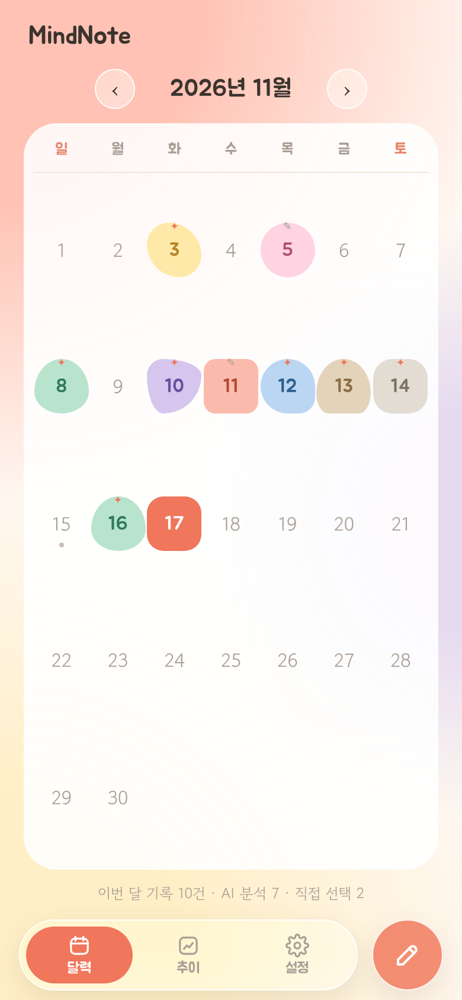
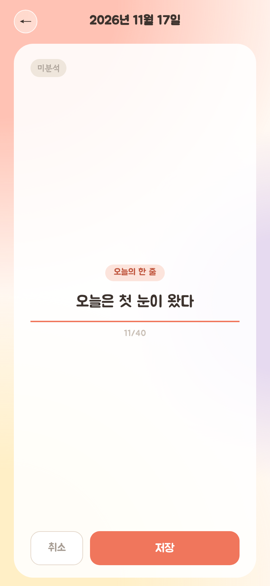
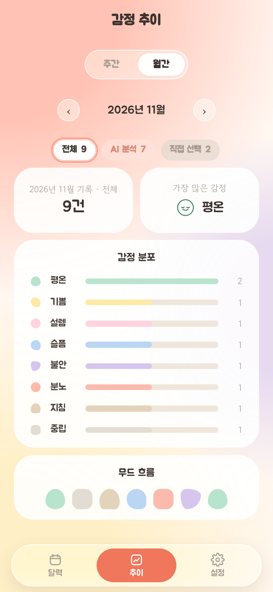
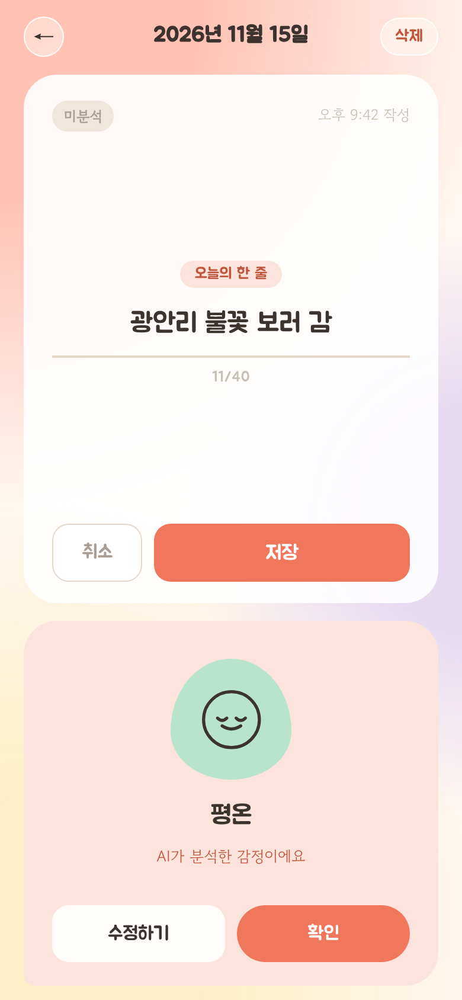
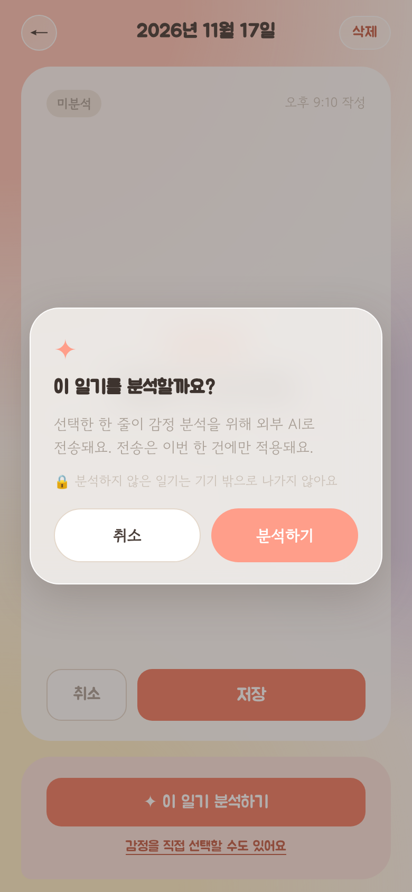
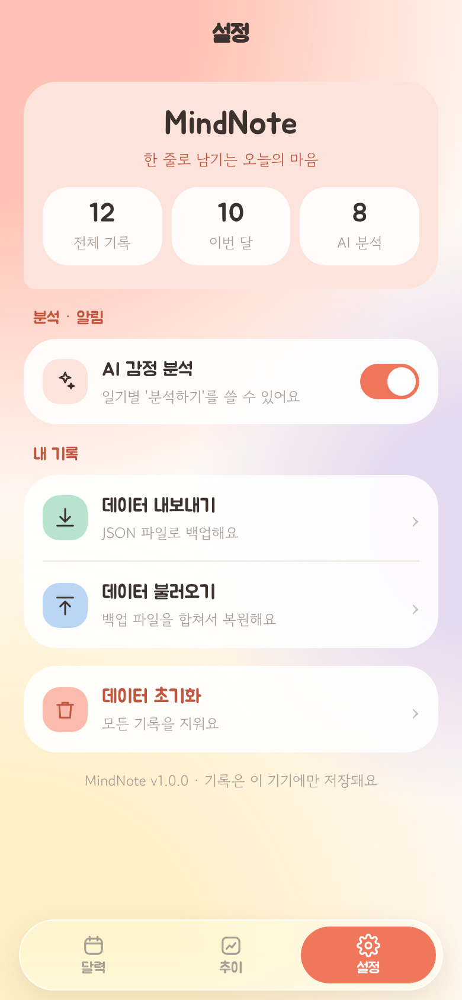

# MindNote

하루 한 줄로 마음을 기록하고, 원할 때만 AI가 감정을 분석해주는 iOS 감정 일기 앱입니다.

## 스크린샷

     

## 주요 기능

| 기능 | 설명 |
|---|---|
| 한 줄 일기 | 달력에서 날짜를 골라 하루 한 줄 기록. 저장은 AI와 완전히 분리되어 오프라인에서도 항상 성공 |
| AI 감정 분석 | 건별 옵트인. 분석하기를 누른 문장만 프록시를 거쳐 외부 LLM으로 전송하고 8종 감정 라벨 중 하나를 제안 |
| 감정 직접 선택 | AI 제안은 참고용. 8종 감정을 직접 고르면 AI가 덮어쓰지 않도록 잠금 |
| 감정 추이 | 주간/월간 감정 분포와 무드 흐름을 로컬 계산만으로 표시 |
| 기록 알림 | 매일 저녁 로컬 알림 |
| 데이터 백업 | JSON 내보내기/불러오기 |

## 프라이버시 설계

MindNote는 개인정보를 수집하지 않습니다. 계정과 로그인이 없고 모든 기록은 기기에만 저장됩니다. AI 감정 분석은 기본 비활성이며, 사용자가 건별로 옵트인한 문장 한 건만 일시 전송되고 저장되지 않습니다. 프록시 서버는 요청 로그를 남기지 않도록 설정했습니다.

개인정보 처리방침: https://m32k.github.io/mindnote-support/privacy.html

지원 페이지: https://m32k.github.io/mindnote-support/

## 기술 스택

| 영역 | 사용 기술 |
|---|---|
| 프론트엔드 | Vanilla JS + Vite SPA, 디자인 토큰 기반 CSS (Liquid Glass × Material 3 Expressive) |
| 글꼴 | Jua, Gowun Dodum (@fontsource로 앱에 번들, 외부 폰트 요청 없음) |
| iOS 패키징 | Capacitor 8.6 (UIScene 라이프사이클, SPM, Local Notifications) |
| AI 프록시 | Node 내장 모듈만 쓰는 프록시 서버. 앱 토큰, CORS 화이트리스트, IP 분당 상한, 일일 쿼터, 동시 실행 제한 |
| 배포 | 시놀로지 NAS Container Manager (앱 · CLIProxyAPI · cloudflared 3개 컨테이너), Cloudflare Tunnel로만 외부 노출 |
| 보안 | 보안 헤더(HSTS, CSP 등), Cloudflare 속도 제한, 웹은 Cloudflare Access 로그인 + 서버 측 JWT 검증 |
| 테스트 | Vitest 124개 + Playwright E2E |
| 개발 방식 | 스펙 우선: 인터뷰, Seed, PRD/기능명세/화면흐름도/ERD/QA 케이스 확정 후 구현 |

## 아키텍처

- 일기 저장은 항상 기기 로컬에서 이뤄지고, 사용자가 옵트인한 AI 분석 요청만 프록시 서버로 나갑니다. 프록시가 외부 LLM API를 호출합니다.
- iOS 앱은 앱 토큰으로, 웹(개인용)은 Cloudflare Access 로그인으로 인증하며 서로 다른 경로를 씁니다. 웹 번들에는 토큰이 들어가지 않고, 서버가 Access JWT(서명, 발급자, aud, 만료, 허용 이메일)를 직접 검증합니다.
- 서버는 공유기 포트를 열지 않고 Cloudflare Tunnel로만 외부에 연결됩니다.

## 업데이트 기록

### 2026-11 · v2 리디자인과 보안 강화

- **디자인 전면 개편**: Liquid Glass × Material 3 Expressive. 반투명 유리 표면, 감정마다 다른 도형과 색, 캡슐형 하단 탭과 FAB
- **화면 재설계**: 달력 균형 조정, 일기 작성·설정 화면 전면 재설계, 감정 선택 2×4 그리드, 감정 추이 타일 정렬
- **iOS 27 SDK 대응**: Capacitor 8.6.2로 업그레이드하고 UIScene(SceneDelegate) 적용
- **서버 이전**: AI 프록시를 시놀로지 NAS의 독립 Docker 스택으로 분리
- **보안 점검**: 보안 헤더 적용, 오류 응답의 모델 원문 노출 제거, 입력 검증 순서 조정, 터널 뒤 실제 클라이언트 IP 기준 속도 제한
- **인증 분리**: 웹은 Cloudflare Access 뒤로 옮기고 서버에서 JWT 검증, 웹 번들에서 앱 토큰 제거, 앱 토큰 교체

### 2026-07 · 첫 버전

| 항목 | 상태 (2026-07-19 기준) |
|---|---|
| 앱 레코드 | com.byungguk.mindnote 생성 완료 |
| 빌드 | 빌드 12 (v1.0) 업로드 및 연결 완료 |
| 가격/지역 | 무료, 175개 국가 및 지역 |
| 개인정보 | 라벨 게시, 처리방침/지원 페이지 연결 (GitHub Pages) |
| 연령 등급 | 4+ |
| 스크린샷 | 6.9인치 10장 등록 |
| 상태 | 심사 제출 대기 |

## 개발기

- [MindNote 개발기 1 - 스펙 우선 개발부터 App Store 심사 제출 준비까지](https://velog.io/@m32k/하루-한-줄-감정-일기-앱-MindNote-개발기-스펙-우선-개발부터-App-Store-심사-제출-준비까지)
- [MindNote 개발기 2 - Liquid Glass 리디자인, NAS 셀프호스팅, 보안 강화까지](https://velog.io/@m32k/MindNote-개발기-2-Liquid-Glass-리디자인-NAS-셀프호스팅-보안-강화까지)

## 문의

sncom1941@gmail.com
